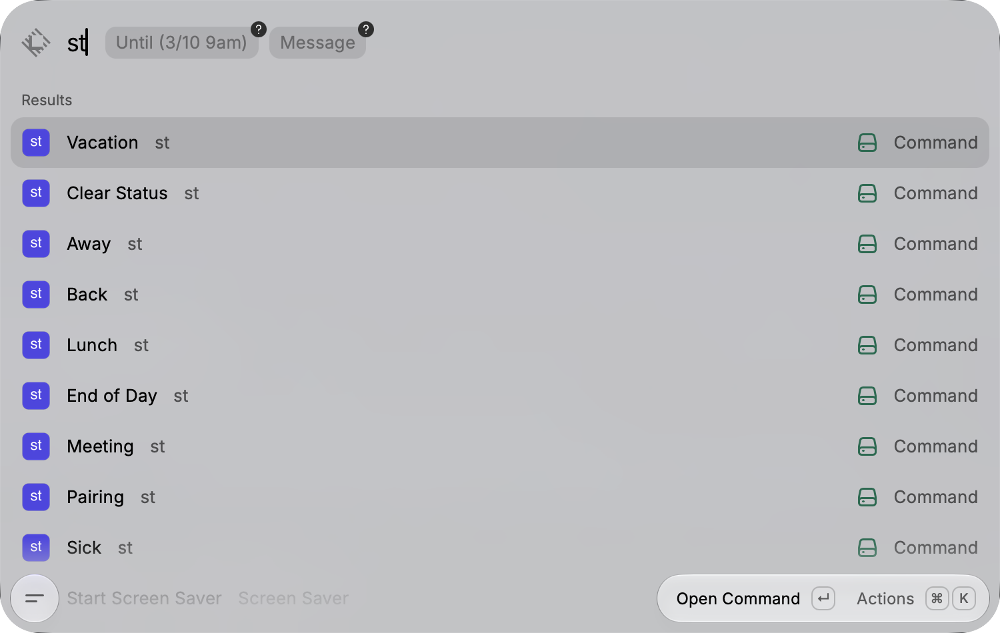

# Status

Raycast commands for [st](https://github.com/wassimk/st), which sets your status across Slack and GitHub with a single command, with reminders for Linear.



> [!CAUTION]
> This is a personal tool and is not published to the Raycast Store. Use at your own risk.

## ✨ Features

- **One Command per Status**: Type `lunch`, `vacation`, or `back` in Raycast and press enter.
- **Optional End Time and Message**: Each command takes an inline "Until" and "Message" argument, using the same date and time formats as `st`.
- **Failure Reporting**: Shows which service failed and why, since `st` keeps going when one service errors.
- **No Install Needed**: Downloads the pinned `st` release from GitHub on first run and verifies its SHA-256 checksum.
- **AI Integration**: Say "put me on vacation until Monday" or "I'm in a meeting until 3pm" in Raycast AI (requires Raycast Pro).

## 🛠️ Setup

Clone the repo and run it in development mode, which adds the extension to Raycast:

```
git clone https://github.com/wassimk/raycast-st.git
cd raycast-st
npm install
npm run dev
```

Raycast asks for two preferences the first time you run a command:

- **Slack Token**: Slack User OAuth Token (`xoxp-...`) with `users.profile:write` and `dnd:write` scopes
- **GitHub Token**: GitHub classic Personal Access Token with `user` and `read:org` scopes

Raycast doesn't load your shell profile, so these are separate from the `SLACK_PAT` and `GITHUB_PAT` environment variables the CLI uses. The extension passes them to `st` under those names.

To limit the GitHub busy status to one organization, create `~/.config/st/config.toml` as described in the [st README](https://github.com/wassimk/st#config-file). The extension uses the same file.

## 💻 Commands

| Command | Arguments | Description |
|---------|-----------|-------------|
| Lunch | Until, Message | 🍴 with DND until the next quarter hour plus an hour |
| Meeting | Until, Message | In a meeting, optionally until a time |
| Pairing | Until, Message | In a pairing session, optionally until a time |
| End of Day | Until, Message | Outside work hours with DND until 7am the next work day |
| Vacation | Until, Message | Off recharging with DND, GitHub busy |
| Sick | Until, Message | Out sick with DND, GitHub busy |
| Away | Until, Message | Away for a bit with DND until 5pm, GitHub busy |
| Back | Message | Clears DND and GitHub busy, catching up for 15 minutes |
| Clear Status | | Clears everything |

Each command also matches `st <keyword>`, like `st away`, so you can type it the same way as the CLI.

"Until" takes a date, a date and time, or a time today, such as `friday`, `tomorrow`, `3/10 9am`, or `2pm`. See the [st README](https://github.com/wassimk/st#date-formats) for every format and the work day rules.

Vacation and Sick have no default end, so they need an "Until" value if you give a "Message". Without one, `st` reads the message as a date and shows a "Could not parse date" error.

After an out of office status, the HUD reminds you to add a Google Calendar out-of-office event, since Linear reads your away status from there.
